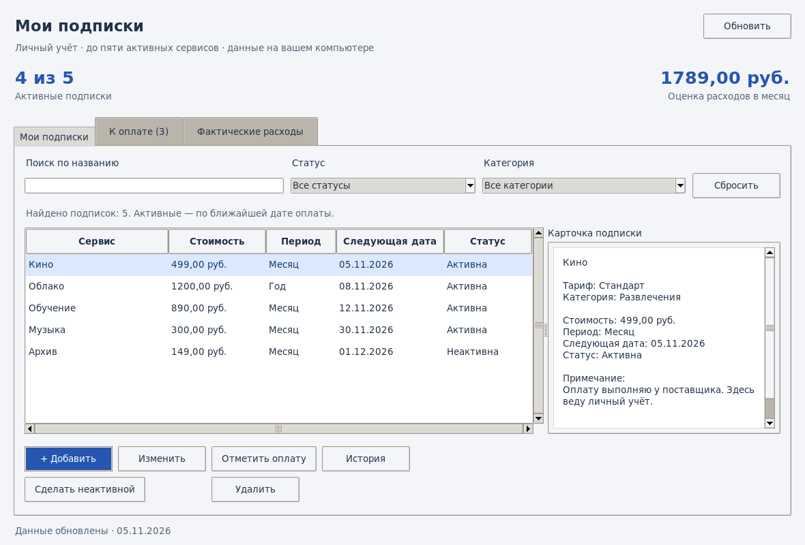
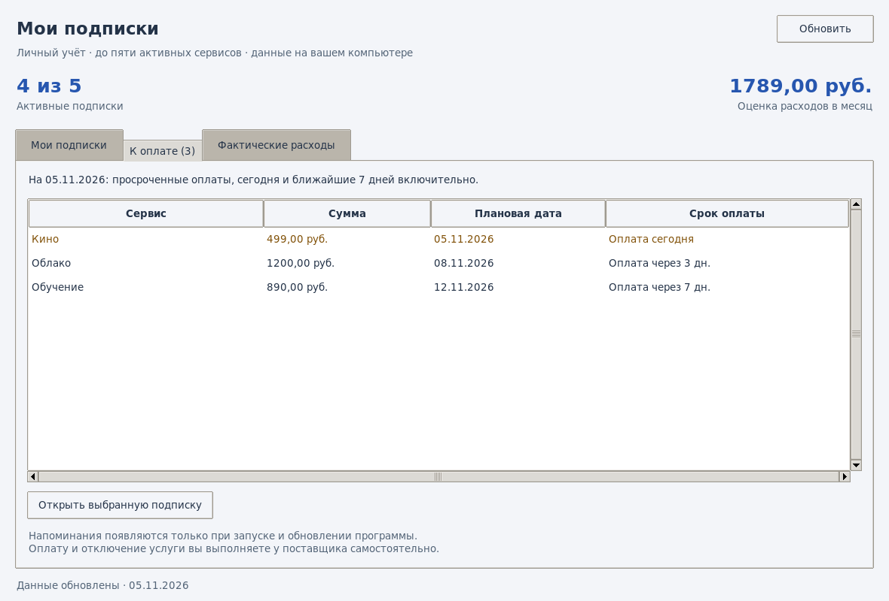
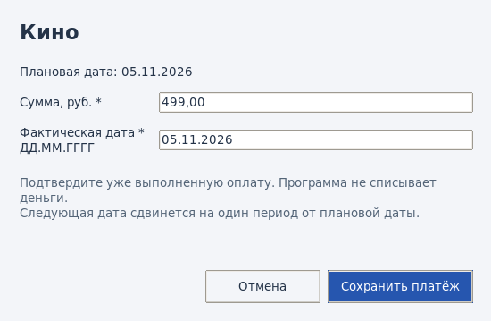
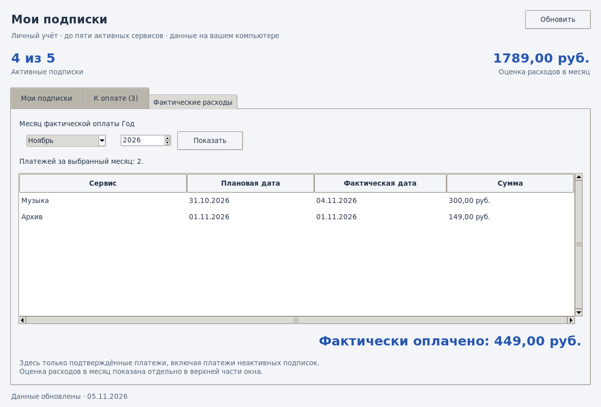

Аккредитованное образовательное частное учреждение  
высшего образования  
«Московский финансово-юридический университет МФЮА»  
(МФЮА)

КАФЕДРА «ИНФОРМАЦИОННЫЕ СИСТЕМЫ И ТЕХНОЛОГИИ»

УТВЕРЖДАЮ  
Заведующий кафедрой  
\_\_\_\_\_\_\_\_\_\_\_\_\_\_\_\_ Изосимова Т. А.  
«\_\_\_\_» \_\_\_\_\_\_\_\_\_\_\_\_\_\_ 20\_\_\_\_ г.

# КУРСОВОЙ ПРОЕКТ

по дисциплине «Разработка программных модулей»

**на тему:  
«Создание приложения для учета и управления подписками на сервисы»**

Направление подготовки (специальность):  
09.02.07 Информационные системы и программирование  
Профиль (специализация): Программист

Автор работы: Белорусцев Егор Сергеевич  
ИНС \_\_\_\_\_\_\_\_\_\_\_\_\_\_\_\_\_\_\_\_  
Курс: 4 Группа: 23Ипо8381 (Ипо-41)  
Подпись \_\_\_\_\_\_\_\_\_\_\_\_\_\_ «\_\_\_\_» \_\_\_\_\_\_\_\_\_\_\_\_\_\_ 20\_\_\_\_ г.

Руководитель работы: преподаватель  
Колпащиков Кирилл Александрович  
Подпись \_\_\_\_\_\_\_\_\_\_\_\_\_\_ «\_\_\_\_» \_\_\_\_\_\_\_\_\_\_\_\_\_\_ 20\_\_\_\_ г.

Работа защищена с оценкой \_\_\_\_\_\_\_\_\_\_\_\_\_\_\_\_\_\_\_\_\_\_\_\_\_\_  
\_\_\_\_\_\_\_\_\_\_\_\_\_\_\_\_\_\_\_\_\_\_\_\_ \_\_\_\_\_\_\_\_\_\_\_\_\_\_\_\_\_\_\_\_\_\_\_\_\_  
(должность, ФИО) (подпись)  
«\_\_\_\_» \_\_\_\_\_\_\_\_\_\_\_\_\_\_ 20\_\_\_\_ г.

Киров — 2026

## ОГЛАВЛЕНИЕ

- [ВВЕДЕНИЕ](#введение)
- [1 АНАЛИЗ ЗАДАЧИ И ОПРЕДЕЛЕНИЕ ТРЕБОВАНИЙ](#1-анализ-задачи-и-определение-требований)
  - [1.1 ПРЕДМЕТНАЯ ОБЛАСТЬ И СПОСОБЫ УЧЁТА](#11-предметная-область-и-способы-учёта)
  - [1.2 ТРЕБОВАНИЯ И КРИТЕРИИ ПРИЁМКИ](#12-требования-и-критерии-приёмки)
  - [1.3 ВЫБОР СРЕДСТВ РАЗРАБОТКИ](#13-выбор-средств-разработки)
- [2 ПРОЕКТИРОВАНИЕ ПРИЛОЖЕНИЯ](#2-проектирование-приложения)
  - [2.1 АРХИТЕКТУРА ПРИЛОЖЕНИЯ](#21-архитектура-приложения)
  - [2.2 МОДЕЛЬ ДАННЫХ И ЦЕЛОСТНОСТЬ](#22-модель-данных-и-целостность)
  - [2.3 РАСЧЁТЫ И ПОДТВЕРЖДЕНИЕ ПЛАТЕЖА](#23-расчёты-и-подтверждение-платежа)
- [3 РЕАЛИЗАЦИЯ И ПРОВЕРКА ПРИЛОЖЕНИЯ](#3-реализация-и-проверка-приложения)
  - [3.1 ИНТЕРФЕЙС И ОСНОВНЫЕ СЦЕНАРИИ](#31-интерфейс-и-основные-сценарии)
  - [3.2 МЕТОДИКА И РЕЗУЛЬТАТЫ ТЕСТИРОВАНИЯ](#32-методика-и-результаты-тестирования)
  - [3.3 УСТАНОВКА И ЭКСПЛУАТАЦИЯ](#33-установка-и-эксплуатация)
- [ЗАКЛЮЧЕНИЕ](#заключение)
- [СПИСОК ИСПОЛЬЗОВАННЫХ ИСТОЧНИКОВ](#список-использованных-источников)
- [ПРИЛОЖЕНИЕ А. СЦЕНАРИЙ ДЕМОНСТРАЦИИ](#приложение-а-сценарий-демонстрации)
- [ПРИЛОЖЕНИЕ Б. СНИМКИ ИНТЕРФЕЙСА](#приложение-б-снимки-интерфейса)

## ВВЕДЕНИЕ

Регулярная оплата цифровых сервисов требует учитывать стоимость, периодичность и сроки. Один человек может пользоваться видеосервисом, облачным хранилищем, музыкальной подпиской и обучающей платформой. Информация о продлении хранится в разных личных кабинетах, поэтому для проверки расходов приходится собирать сведения вручную. Единый реестр позволяет видеть действующие подписки, ближайшие даты и выполненные платежи в одном окне.

Тема курсового проекта — «Создание приложения для учета и управления подписками на сервисы». В рамках проекта управление состоит в добавлении и изменении записей, планировании срока оплаты, смене статуса и ведении истории. Пользователь выполняет оплату у поставщика сервиса, а затем подтверждает её в приложении. Такое разделение позволяет реализовать учёт на одном компьютере и хранить данные локально.

Цель работы — разработать настольное приложение для хранения сведений о подписках, контроля предстоящих платежей и расчёта расходов пользователя.

Для достижения цели решаются задачи, определённые в индивидуальном задании.

– Проанализировать предметную область и определить требования к приложению.

– Спроектировать структуру базы данных и пользовательский интерфейс.

– Реализовать добавление, просмотр, изменение и удаление записей.

– Реализовать контроль сроков, подтверждение платежей и расчёт расходов.

– Проверить работоспособность приложения и оформить документацию.

Объект исследования — личный учёт подписок на цифровые сервисы. Предмет исследования — программные средства хранения сведений о подписках, расчёта расходов и обработки подтверждённых платежей. При разработке использованы анализ пользовательских сценариев, сравнение способов учёта, реляционное моделирование и модульное проектирование. Проверка опирается на тесты с фиксированными датами и отдельными временными базами.

Основы программирования на Python представлены в учебных изданиях М. Лутца и Э. Мэтиза \[5, 6\]. Построение графических приложений на Tkinter рассматривает А. Мур \[7\]. Приёмы работы с реляционными данными описаны Э. ДеБарросом \[4\]. Для данной задачи эти подходы объединены в последовательный процесс, в котором карточка подписки связана с графиком и журналом оплаты.

Практический результат — приложение «Мои подписки» на Python с интерфейсом Tkinter и локальной базой SQLite. Оно рассчитано на одного пользователя и поддерживает до пяти активных подписок. Выполненные платежи сохраняются независимо от дальнейшего статуса сервиса. В репозитории размещены исходный код, автоматические тесты, инструкция запуска и проверка соответствия требованиям \[17\].

В первой главе рассматриваются способы учёта подписок, требования и выбор инструментов. Во второй главе приведены архитектура, модель данных и алгоритмы. В третьей главе описаны интерфейс, результаты проверки и порядок эксплуатации. Структура записки и оформление ссылок приняты по методическим материалам МФЮА \[2, 3\].

## 1 АНАЛИЗ ЗАДАЧИ И ОПРЕДЕЛЕНИЕ ТРЕБОВАНИЙ

### 1.1 ПРЕДМЕТНАЯ ОБЛАСТЬ И СПОСОБЫ УЧЁТА

Подписка — запись о регулярном доступе к определённому сервису. Для учёта необходимы название, стоимость, период оплаты и очередная дата. Тариф уточняет условия обслуживания, категория помогает отбирать записи, а примечание сохраняет дополнительную информацию пользователя. Например, для сервиса «Облако» можно указать тариф «Личный» и категорию «Хранение».

Плановая дата показывает, когда по графику следует выполнить очередную оплату. Фактическая дата относится к уже совершённому платежу. При задержке они различаются, поэтому обе даты должны сохраняться. Стоимость в карточке описывает текущие условия подписки. В истории платежа хранится сумма, которую пользователь подтвердил за конкретный период. Благодаря этому изменение тарифа сохраняет прежние расходы в исходном размере.

Активный статус включает подписку в оценку расходов и список ближайших оплат. После завершения учёта запись переводится в неактивное состояние, а история остаётся доступной. Так пользователь может освободить место в реестре активных сервисов и продолжить анализировать фактические расходы за прошлые месяцы.

В блокноте человек самостоятельно проверяет даты и складывает суммы. Электронная таблица помогает отбирать записи и выполнять вычисления, однако правила переноса сроков и хранения истории приходится формулировать отдельно. Специализированная программа объединяет эти операции в последовательный сценарий. Сравнение подходов приведено в таблице 1.

Таблица 1 – Сравнение способов учёта подписок[^1]

| **Способ**           | **Возможности**                             | **Что требуется от пользователя**               |
|----------------------|---------------------------------------------|-------------------------------------------------|
| Ручные записи        | Свободное описание условий подписки         | Проверять даты, складывать суммы, вести историю |
| Электронная таблица  | Фильтры, формулы, табличное хранение        | Настроить поля, график и правила переноса дат   |
| Локальное приложение | Карточка, график, история и расчёт расходов | Ввести условия подписки и подтвердить оплату    |

Для проекта выбран локальный реестр с заданными полями и проверками. Типовой сценарий проходит от создания карточки к проверке ближайшего срока, затем к подтверждению оплаты и просмотру истории. Смена статуса завершает текущий учёт сервиса и сохраняет сведения о прошлых платежах.

### 1.2 ТРЕБОВАНИЯ И КРИТЕРИИ ПРИЁМКИ

Индивидуальное задание предусматривает анализ задачи, проектирование базы и интерфейса, работу с записями, контроль сроков, расчёт расходов и проверку программы. В рабочей спецификации выделены бизнес-требования, правила учёта, функции, задачи пользователя и технические ограничения \[18\]. ГОСТ 19.201–78 используется как источник по составу технического задания \[1\].

Для каждой группы требований определён наблюдаемый результат. Например, добавление считается успешным после появления записи в списке и её учёта в сводке. При ошибке сохранения ожидается пояснение и сохранение прежнего состояния базы. Основные критерии приведены в таблице 2.

Таблица 2 – Требования и критерии приёмки[^2]

| **Группа**       | **Ожидаемое поведение**                                                                                     |
|------------------|-------------------------------------------------------------------------------------------------------------|
| Ведение реестра  | Карточку можно добавить, открыть и изменить. Отмена закрывает форму без записи.                             |
| Лимит и статусы  | При пяти активных записях создание и активация отклоняются. Деактивация освобождает место.                  |
| Сроки и оплата   | Выводятся просрочка, оплата сегодня и сроки на ближайшие семь дней. Платёж сохраняется после подтверждения. |
| Расходы          | Оценка рассчитывается по активным подпискам. История месяца учитывает фактические даты платежей.            |
| Защита истории   | Удаление подписки с платежами отклоняется. Отказ записи платежа сохраняет прежнюю дату.                     |
| Локальная работа | Данные доступны после повторного запуска. Второй экземпляр с той же базой блокируется.                      |

Для названия сервиса требуется от 1 до 100 символов после удаления пробелов по краям. Тариф допускает до 100, категория — до 50, примечание — до 500 символов. Поля тарифа, категории и примечания заполняются по желанию. Стоимость подписки и сумма отдельного платежа находятся в пределах от 0,01 до 99 999,99 рубля. Допускаются точка или запятая и не более двух цифр после разделителя.

Плановый срок вводится в формате ДД.ММ.ГГГГ и проверяется по календарю. Прошедшая плановая дата позволяет учесть просрочку. Фактическая дата платежа ограничена сегодняшним днём или более ранней датой. При ошибке приложение показывает поле и причину, сохраняя форму для исправления.

Пользовательские требования описывают действия в окне, от создания первой подписки до просмотра истории после повторного запуска. Они связаны с функциями приложения в файле docs/requirements.md. В матрице учтено 51 требование из рабочей спецификации. Для правил, которые влияют на сохранённые данные, указаны проверки базы и сервиса, а для действий в формах приведены графические сценарии \[17, 18\].

Условия эксплуатации задают один локальный профиль, рубли, месячный и годовой периоды. Неактивные записи сохраняются вне лимита пяти активных подписок. Основные действия выполняются без Интернета. Русские подписи, дата в привычном формате и сумма с двумя десятичными знаками позволяют использовать реестр без специальных знаний.

### 1.3 ВЫБОР СРЕДСТВ РАЗРАБОТКИ

Python выбран для настольного приложения с небольшим числом модулей. Стандартные средства языка охватывают работу с графическими окнами, SQLite, календарём, десятичной арифметикой и тестами \[5, 6, 8–12\]. В рабочей версии обязательные пакеты для установки через pip отсутствуют. Для отображения окон нужна установка Python с компонентом Tcl/Tk.

Интерфейс реализован на Tkinter и тематических виджетах ttk \[7, 8\]. Вкладки разделяют реестр, напоминания и фактические расходы. Таблица показывает общие сведения, карточка — подробности, а диалоги собирают данные для отдельных операций. Такое устройство подходит для демонстрации на одном компьютере и позволяет проверять правила учёта отдельно от графических компонентов.

SQLite хранит таблицы в локальном файле. Подключение создаётся в программе через модуль sqlite3, который позволяет выполнять запросы с параметрами и управлять транзакциями \[4, 9\]. Для однопользовательской работы достаточно переносить папку программы вместе с файлом данных. Установка отдельной серверной службы для этого варианта не требуется.

В индивидуальном задании документация PostgreSQL названа одним из источников информации. PostgreSQL использует отдельный серверный процесс и клиентские подключения \[16\]. При выборе между этим подходом и SQLite учитывалось, что проект рассчитан на один локальный профиль. В реализованной версии используется SQLite. Серверная схема потребовала бы настроить подключение и отдельно проверить работу нескольких клиентов.

При обработке денежных полей применён тип Decimal \[10\]. Строка «300,00» преобразуется в 30 000 копеек. Целочисленное хранение позволяет складывать платежи без погрешностей представления дробных значений. Правило округления применяется к итоговой оценке, полученной после приведения годовых расходов к месяцу.

Календарные значения представлены объектами date \[11\]. Проверка даты выполняется до сохранения. При переносе срока учитываются длина целевого месяца и исходный день графика. Отдельные функции расчётов можно проверять независимо от интерфейса, передавая им заданные данные и дату.

В PyCharm открывается папка проекта, выбирается интерпретатор и запускается main.py. Для автоматических проверок используется unittest \[12\]. Проверки выполняются в отдельной копии кода и на временных базах. Такой порядок упрощает воспроизведение сценариев и сохраняет пользовательские записи.

## 2 ПРОЕКТИРОВАНИЕ ПРИЛОЖЕНИЯ

### 2.1 АРХИТЕКТУРА ПРИЛОЖЕНИЯ

Программа состоит из интерфейса, сервиса и модуля хранения. Интерфейс получает введённые значения и показывает состояние реестра. Сервис применяет правила учёта и задаёт порядок изменения записей. Модуль хранения выполняет запросы SQLite. Функции проверки данных, денежных расчётов и календаря вынесены в модуль предметной логики. На рисунке 1 показано направление обращения при сохранении \[17\].

<table>
<colgroup>
<col style="width: 28%" />
<col style="width: 7%" />
<col style="width: 29%" />
<col style="width: 7%" />
<col style="width: 28%" />
</colgroup>
<thead>
<tr class="header">
<th>Интерфейс 
Окно и диалоги</th>
<th>→</th>
<th>Сервис 
Правила учёта</th>
<th>→</th>
<th>Хранение 
Файл SQLite</th>
</tr>
</thead>
<tbody>
</tbody>
</table>

Рисунок 1 – Взаимодействие компонентов приложения[^3]

Точка входа main.py определяет путь к файлу данных относительно папки проекта. При запуске создаётся скрытое окно Tkinter, затем захватывается блокировка, открывается база и формируется интерфейс. Объект Application получает SubscriptionService, а сервис работает с объектом Database. При завершении закрывается соединение, освобождается блокировка и уничтожается окно.

Диалоги передают сервису данные операции. Например, для подтверждения оплаты нужны идентификатор подписки, ожидаемая плановая дата, введённая сумма и фактическая дата. Проверки и изменение базы выполняются в сервисе. Благодаря такому разделению алгоритм можно проверить независимо от отображения кнопок и полей.

После успешной операции интерфейс заново получает список, сводку, сроки и платежи. Фильтры применяются к выдаче реестра. Общая сводка рассчитывается по всем записям и сохраняет значения при отборе. Назначение файлов проекта приведено в таблице 3.

Таблица 3 – Назначение модулей программы[^4]

| **Файл**               | **Ответственность**                             |
|------------------------|-------------------------------------------------|
| main.py                | Запуск, путь к базе и закрытие приложения       |
| domain.py              | Модели, валидация, календарь и денежные расчёты |
| service.py             | Операции учёта и проверка бизнес-правил         |
| database.py            | Создание схемы, запросы и транзакции            |
| instance.py            | Блокировка экземпляра для файла базы            |
| ui.py                  | Главное окно, вкладки, фильтры и обновление     |
| dialogs.py, widgets.py | Формы операций, таблицы и прокрутка             |

Сервис преобразует известные нарушения ограничений в сообщения о заполненном лимите или повторной оплате. Ошибки чтения и записи обрабатываются в окне и диалогах. Форма сохранения закрывается после успешного завершения операции. При ошибке пользователь может исправить ввод и повторить действие.

### 2.2 МОДЕЛЬ ДАННЫХ И ЦЕЛОСТНОСТЬ

База содержит таблицы subscriptions и payments. У одной подписки может быть несколько платежей либо ни одного. Платёж связан с подпиской по идентификатору. Схема связи представлена на рисунке 2. Ограничение внешнего ключа запрещает удалять подписку с платежами \[13, 17\].

<table>
<colgroup>
<col style="width: 38%" />
<col style="width: 15%" />
<col style="width: 45%" />
</colgroup>
<thead>
<tr class="header">
<th>Подписка 
Первичный ключ id</th>
<th>1 → 0…N</th>
<th>Платёж 
Внешний ключ subscription_id</th>
</tr>
</thead>
<tbody>
</tbody>
</table>

Рисунок 2 – Связь подписки с платежами[^5]

В карточке сохраняются действующие условия. Для расчёта графика используются следующая дата и исходная дата. Поля подписки перечислены в таблице 4, а поля платежа — в таблице 5.

Таблица 4 – Поля таблицы подписок[^6]

| **Поле**       | **Назначение**                                |
|----------------|-----------------------------------------------|
| id             | Первичный ключ подписки                       |
| service, plan  | Сервис и тариф, до 100 символов каждый        |
| category, note | Категория до 50 и примечание до 500 символов  |
| amount_cents   | Стоимость в целых копейках, от 1 до 9 999 999 |
| period         | Месячный или годовой период                   |
| next_date      | Следующий плановый срок в формате ГГГГ-ММ-ДД  |
| active         | Признак активности, 0 или 1                   |
| anchor_date    | Исходная дата календарного графика            |

Таблица 5 – Поля таблицы платежей[^7]

| **Поле**        | **Назначение**                     |
|-----------------|------------------------------------|
| id              | Первичный ключ платежа             |
| subscription_id | Ссылка на существующую подписку    |
| planned_date    | Плановая дата оплаченного периода  |
| actual_date     | Дата фактической оплаты            |
| amount_cents    | Фактическая сумма в целых копейках |

История получает название сервиса через связь таблиц. В строке платежа отдельно сохранены сумма и обе даты. Редактирование условий подписки оставляет эти значения прежними. При показе истории выбранного месяца запрос отбирает строки по году и месяцу фактической даты.

При открытии соединения приложение включает проверку внешних ключей командой PRAGMA foreign_keys = ON. Внешний ключ с правилом ON DELETE RESTRICT защищает историю на уровне SQLite. Сервис также проверяет наличие платежей, чтобы объяснить отказ ещё до удаления \[13, 17\].

Уникальность пары subscription_id и planned_date ограничивает учёт одним платежом за плановый срок. Это правило сохраняется даже после ручной смены графика на ранее оплаченный период. Схема проверяет целочисленность сумм, диапазон копеек и допустимые значения периода. Нормализованная строка даты должна совпадать с сохранённой строкой. Интерфейс дополнительно проверяет ввод по календарю.

За лимит отвечают два триггера SQLite. Один контролирует вставку новой активной записи, другой — переход из неактивного состояния в активное. Проверка в сервисе даёт понятное сообщение, а триггер защищает таблицу при прямой записи. Обычное редактирование активной карточки разрешено при заполненном лимите \[15, 17\].

Схема включает индексы фактической даты платежа, активности и следующего срока подписки. Категория хранится в текстовом поле карточки, что соответствует фильтру без отдельного справочника. При первом запуске создаётся пустая база версии 1. Проверка номера версии предупреждает об открытии несовместимого файла.

### 2.3 РАСЧЁТЫ И ПОДТВЕРЖДЕНИЕ ПЛАТЕЖА

Оценка расходов в месяц рассчитывается для всех активных подписок по формуле (1).

$E = \operatorname{round}(M + Y / 12)$ (1)

В формуле E — месячная оценка в копейках, M — сумма месячных стоимостей, Y — сумма годовых стоимостей. Округление выполняется до целой копейки по правилу ROUND_HALF_UP \[10, 17\].

Годовые суммы сначала складываются, затем общий результат делится на двенадцать. Например, подписки за 300 рублей в месяц и 1200 рублей в год дают оценку 400 рублей в месяц. Если две годовые стоимости равны 0,01 и 0,05 рубля, их вклад составляет 0,005 рубля до округления и 0,01 рубля после округления. Последовательность операций сохраняет эту копейку \[10, 17\].

Фактические расходы формируются по подтверждённым платежам выбранного календарного месяца. Годовой платёж учитывается целиком в месяце его фактической оплаты. Неактивный статус исключает текущую цену из оценки и сохраняет прежние платежи в месячном итоге. При отсутствии записей сумма фактических расходов равна нулю.

Для напоминаний вычисляется число дней от сегодняшней даты до очередного срока. Отрицательное значение означает просрочку. Нулевое значение соответствует оплате сегодня. В ближайшие сроки входят дни с первого по седьмой включительно. Для неактивных подписок напоминания пропускаются.

При переносе месячного срока вычисляются следующий месяц и число дней в нём. День новой даты берётся из исходного графика и ограничивается последним днём целевого месяца. На рисунке 3 показан переход через февраль невисокосного года.

31 января 2027 г. → 28 февраля 2027 г. → 31 марта 2027 г.

Рисунок 3 – Перенос срока с сохранением исходного дня[^8]

Годовая подписка использует месяц и день исходной даты. Для 29 февраля в невисокосном году выбирается 28 февраля. При наступлении високосного года исходный день восстанавливается. Изменение периода или очередной даты устанавливает новую исходную дату. Редактирование цены, названия и статуса при прежнем графике сохраняет её.

Подтверждение оплаты начинается после выбора активной подписки. Форма предлагает сумму из карточки и сегодняшнюю фактическую дату. Пользователь проверяет сведения и подтверждает уже совершённый платёж. Сервис проверяет сумму, формат даты и запрет будущей оплаты. Затем он повторно читает карточку в транзакции.

Ожидаемая плановая дата передаётся из открытой формы. Если после её открытия срок уже изменился, запрос отклоняется. Такой контроль позволяет отличить повторное нажатие от осознанного подтверждения следующего периода. В форме на время сохранения отключается кнопка. Ограничение уникальности в базе дополнительно защищает историю при возврате к прежнему графику \[17\].

Сохранение платежа выполняется в следующем порядке.

– Прочитать подписку и проверить её активность и ожидаемый срок.

– Рассчитать следующую дату по плановому сроку и исходному графику.

– Добавить строку платежа с суммой и обеими датами.

– Обновить следующий срок подписки и зафиксировать транзакцию.

– Обновить карточку, сводку, историю и список напоминаний.

Транзакция начинается командой BEGIN IMMEDIATE. Ошибка вставки платежа или обновления срока вызывает откат обоих действий. После отката прежняя дата остаётся в карточке, а новая запись отсутствует в истории. Для расчёта очередного срока за пределами 9999 года сервис возвращает ошибку до вставки платежа \[14, 17\].

При поздней оплате новая дата определяется от предыдущей плановой даты. Срок сдвигается на один месяц или год. Если накопилось несколько пропусков, он может остаться просроченным. Для следующего оплаченного периода пользователь открывает новую форму. При просмотре реестра или наступлении срока платежи автоматически не создаются.

## 3 РЕАЛИЗАЦИЯ И ПРОВЕРКА ПРИЛОЖЕНИЯ

### 3.1 ИНТЕРФЕЙС И ОСНОВНЫЕ СЦЕНАРИИ

В главном окне есть сводка и вкладки «Мои подписки», «К оплате» и «Фактические расходы». Сводка показывает число активных подписок и оценку расходов в месяц. Реестр с поиском, фильтрами статуса и категории, списком и карточкой показан в приложении Б (рисунок Б.1).

На рисунке Б.1 видны четыре активные подписки. Месячная оценка составляет 1789 рублей (499 + 890 + 300 + 1200 / 12). Неактивная запись «Архив» видна в списке и не занимает место в лимите.

Вкладка «К оплате» показывает ближайшие даты и текстовые пояснения (рисунок Б.2). Кнопка «Открыть выбранную подписку» переводит к карточке и сбрасывает фильтры, которые могли скрыть запись.

Форма оплаты заполняет текущую стоимость и сегодняшнюю дату. Пользователь проверяет фактические сведения и сохраняет платёж (рисунок Б.3).

На вкладке «Фактические расходы» выбирают месяц и год и нажимают «Показать». В таблице видны сервис, плановая и фактическая даты, сумма платежа. Итог за выбранный месяц показан на рисунке Б.4.

Добавление и изменение подписки выполняются через общую форму. При изменении в неё подставляются значения карточки. Сообщение об ошибке отображается в форме, а отмена закрывает её без записи. В пустом реестре пользователь видит предложение добавить подписку. При отборе без совпадений показывается сообщение о результате поиска.

Кнопка «История» открывает платежи выбранного сервиса. Смена статуса сохраняет платежи и обновляет сводку. При возобновлении предлагается проверить следующую дату.

### 3.2 МЕТОДИКА И РЕЗУЛЬТАТЫ ТЕСТИРОВАНИЯ

Для проверки использован исходный код из коммита 6239169 \[17\]. Тесты запускаются средствами unittest. Для каждого сценария создаётся временная база, а в проверках напоминаний и оплаты используется фиксированная дата \[12\]. Команда запуска выполняется из папки проекта.

python -m unittest discover -s tests -v

Число тестов по группам и результат повторного прогона приведены в таблице 6.

Таблица 6 – Результаты автоматических проверок[^9]

| **Группа**         | **Тестов** | **Результат повторного прогона**                                          |
|--------------------|------------|---------------------------------------------------------------------------|
| Предметная логика  | 6          | Пройдены проверки сумм, дат и текста                                      |
| Сервис и база      | 22         | Пройдены проверки лимита, истории, расчётов и отката                      |
| Блокировка         | 3          | Пройдены проверки второго процесса, освобождения блокировки и пути к базе |
| Интерфейс и запуск | 15         | Пропущены из-за отсутствия графического экрана                            |
| Всего              | 46         | 31 пройден, 15 пропущены                                                  |

Повторная проверка выполнена 8 ноября 2026 года в Linux с Python 3.13.5 и SQLite 3.46.1. Ошибок в выполненных тестах нет. В README репозитория указан предыдущий полный прогон 46 тестов в Linux с Tk 8.6 на виртуальном экране. В текущем прогоне графические сценарии отмечены как пропущенные \[17\].

Проверки охватывают граничные суммы, ошибочные даты, шестую активную запись и редактирование при заполненном лимите. Для напоминаний проверяются вчерашний срок, сегодня, семь и восемь дней. Календарные сценарии подтверждают восстановление 31-го числа после февраля и перенос годового срока с учётом високосных лет.

В тестах хранения отдельно моделируются отказ вставки платежа и отказ изменения очередной даты. После каждого отказа остаётся исходное состояние. Проверки дубликатов, внешнего ключа и повторного открытия базы подтверждают защиту истории. Ручной порядок проверки на пользовательском компьютере приведён в docs/manual-checks.md \[17\].

### 3.3 УСТАНОВКА И ЭКСПЛУАТАЦИЯ

Для запуска в Windows используется Python с компонентом Tcl/Tk. В инструкции проекта рекомендован Python 3.12. В PyCharm следует открыть папку kursach и выбрать интерпретатор проекта. Команда python -m tkinter открывает диагностическое окно. После проверки его закрывают и запускают main.py из PyCharm или терминала \[8, 17\].

На первом запуске создаётся файл data/subscriptions.sqlite3 относительно main.py. Такой путь сохраняется при запуске из другого рабочего каталога. Список изначально пуст. При повторном запуске приложение загружает сохранённые сведения из той же базы.

Одновременный запуск двух экземпляров с одной базой ограничивает блокировка файла. В Windows используется msvcrt, в Linux — flock. Блокировку удерживает операционная система. После завершения процесса она освобождается. Технический файл с расширением .lock может оставаться в папке данных.

Для переноса на другой компьютер следует закрыть приложение и скопировать папку проекта вместе с data. Для резервной копии достаточно сохранить папку data после закрытия. В репозитории хранятся исходный код и инструкции. Пользовательская база, виртуальное окружение и локальные настройки среды исключены из Git \[17\]. Сценарий демонстрации приведён в приложении А.

## ЗАКЛЮЧЕНИЕ

В ходе курсового проекта разработано настольное приложение «Мои подписки». Оно ведёт реестр сервисов, показывает предстоящие сроки, рассчитывает месячную оценку и хранит подтверждённые платежи. Основные операции доступны на одном компьютере без подключения к Интернету. Реализованный набор функций соответствует задаче личного учёта.

Анализ предметной области позволил отделить условия подписки от уже выполненной оплаты. У карточки есть цена, период и плановый срок. В истории сохраняются сумма и фактическая дата каждого подтверждённого платежа. Это даёт возможность менять условия обслуживания и получать достоверный итог расходов за выбранный месяц.

Модель данных построена на двух связанных таблицах SQLite. Сервис проверяет требования к данным и управляет транзакциями, а графические формы передают ему действия пользователя. Разделение модулей позволяет проверять расчёты и сохранение без запуска интерфейса. Внешний ключ и ограничения базы сохраняют историю при изменениях реестра.

Лимит пяти активных подписок действует при создании и возобновлении. Неактивные записи остаются доступными для просмотра. Расчёт сводки учитывает только активные сервисы, а фактический итог сохраняет ранее подтверждённые платежи. На этих правилах основаны основные сценарии эксплуатации.

Хранение сумм в копейках позволяет складывать платежи с заданной точностью. Средняя месячная нагрузка рассчитывается после приведения годовых стоимостей к месяцу. Календарный алгоритм сохраняет исходный день графика, поэтому короткий месяц корректирует только ближайшую дату. Подтверждение платежа и перенос срока фиксируются совместно.

Повторный прогон подтвердил 31 тест предметной логики, сервиса, базы и блокировки. В графической группе 15 сценариев пропущены из-за отсутствия экрана. Для показа на компьютере с Windows подготовлена последовательность действий от первой записи до проверки истории после перезапуска.

Практическая ценность проекта определяется возможностью объединить сведения о сервисах и выполнить полный цикл локального учёта. Подготовленные инструкции позволяют установить программу, найти файл базы и сохранить данные при переносе проекта. Матрица требований связывает ожидаемое поведение с модулями и проверками.

Дальнейшее развитие может включать экспорт истории и создание резервной копии из интерфейса. Эти функции потребуют определить формат данных и добавить проверки восстановления. Для текущей версии задача курсового проекта завершена в границах согласованной спецификации.

## СПИСОК ИСПОЛЬЗОВАННЫХ ИСТОЧНИКОВ

1\. ГОСТ 19.201–78. Единая система программной документации. Техническое задание. Требования к содержанию и оформлению \[Электронный ресурс\]. — URL: https://protect.gost.ru/gost/details/b64061cf-6bb2-4c75-aee9-18bb5e26e554 (дата обращения: 05.11.2026).

2\. Московский финансово-юридический университет МФЮА. Методические указания по подготовке и оформлению курсовых работ/проектов \[Текст\]. — Москва, 2025.

3\. Московский финансово-юридический университет МФЮА. Методические рекомендации по подготовке и проверке научных работ на оригинальность в системе «Антиплагиат» \[Текст\]. — Москва, 2025.

4\. DeBarros, A. Practical SQL: A Beginner’s Guide to Storytelling with Data \[Текст\]. — 2nd ed. — No Starch Press, 2022. — 464 p. — ISBN 978-1-71850-106-5.

5\. Lutz, M. Learning Python: Powerful Object-Oriented Programming \[Текст\]. — 6th ed. — O’Reilly Media, 2025.

6\. Matthes, E. Python Crash Course: A Hands-On, Project-Based Introduction to Programming \[Текст\]. — 3rd ed. — No Starch Press, 2023. — 552 p. — ISBN 978-1-71850-270-3.

7\. Moore, A. D. Python GUI Programming with Tkinter \[Текст\]. — 2nd ed. — Packt Publishing, 2021. — 664 p. — ISBN 978-1-80181-592-5.

8\. Python Software Foundation. tkinter — Python interface to Tcl/Tk \[Электронный ресурс\]. — Python 3.12 Documentation. — URL: https://docs.python.org/3.12/library/tkinter.html (дата обращения: 05.11.2026).

9\. Python Software Foundation. sqlite3 — DB-API 2.0 interface for SQLite databases \[Электронный ресурс\]. — Python 3.12 Documentation. — URL: https://docs.python.org/3.12/library/sqlite3.html (дата обращения: 05.11.2026).

10\. Python Software Foundation. decimal — Decimal fixed-point and floating-point arithmetic \[Электронный ресурс\]. — Python 3.12 Documentation. — URL: https://docs.python.org/3.12/library/decimal.html (дата обращения: 05.11.2026).

11\. Python Software Foundation. datetime — Basic date and time types \[Электронный ресурс\]. — Python 3.12 Documentation. — URL: https://docs.python.org/3.12/library/datetime.html (дата обращения: 05.11.2026).

12\. Python Software Foundation. unittest — Unit testing framework \[Электронный ресурс\]. — Python 3.12 Documentation. — URL: https://docs.python.org/3.12/library/unittest.html (дата обращения: 05.11.2026).

13\. SQLite. SQLite Foreign Key Support \[Электронный ресурс\]. — URL: https://www.sqlite.org/foreignkeys.html (дата обращения: 05.11.2026).

14\. SQLite. Transaction \[Электронный ресурс\]. — URL: https://www.sqlite.org/lang_transaction.html (дата обращения: 05.11.2026).

15\. SQLite. CREATE TRIGGER \[Электронный ресурс\]. — URL: https://www.sqlite.org/lang_createtrigger.html (дата обращения: 05.11.2026).

16\. PostgreSQL Global Development Group. Architectural Fundamentals \[Электронный ресурс\]. — PostgreSQL 18 Documentation. — URL: https://www.postgresql.org/docs/18/tutorial-arch.html (дата обращения: 05.11.2026).

17\. Белорусцев Е. С. Мои подписки: исходный код курсового проекта \[Электронный ресурс\]. – Редакция 6239169. – URL: https://github.com/bezlyk/kursach/tree/6239169e0544b4a7eff4c92b94e55c4a517b7c28 (дата обращения: 08.11.2026).

18\. Требования к приложению для учёта и управления подписками на сервисы \[Текст\]. – Рабочая спецификация курсового проекта. – 2026. – 6 с.

## ПРИЛОЖЕНИЕ А. СЦЕНАРИЙ ДЕМОНСТРАЦИИ

Для показа работы можно использовать отдельную копию проекта с пустой базой. Достаточно пройти следующий сценарий.

– Добавить месячную подписку за 300 рублей и годовую за 1200 рублей. Сводка должна показать оценку 400 рублей.

– Проверить поиск и фильтры. Открыть карточку и сохранить допустимое изменение.

– Отметить выполненную оплату, проверить следующий срок и фактический итог месяца.

– Сделать подписку неактивной. Убедиться, что история доступна, а сводка пересчитана.

– Перезапустить программу и проверить сохранённые записи.

Базовая версия рассчитана на одного пользователя, рубли, месячные и годовые периоды. Оплату и отключение услуги пользователь выполняет у поставщика. В комплект проекта входят исходники, папка тестов, руководство запуска, матрица требований и ручной сценарий проверки \[17\].

## ПРИЛОЖЕНИЕ Б. СНИМКИ ИНТЕРФЕЙСА

Демонстрационные данные на 5 ноября 2026 года.

Рисунок Б.1 – Реестр и карточка подписки[^10]

Рисунок Б.2 – Сроки оплаты и напоминания[^11]

Рисунок Б.3 – Подтверждение выполненной оплаты[^12]

Рисунок Б.4 – Фактические расходы выбранного месяца[^13]

[^1]: Составлено по результатам анализа задачи.

[^2]: Составлено по материалам проекта \[17, 18\].

[^3]: Составлено по исходному коду \[17\].

[^4]: Составлено по структуре репозитория \[17\].

[^5]: Составлено по исходному коду \[17\].

[^6]: Составлено по схеме базы данных \[17\].

[^7]: Составлено по схеме базы данных \[17\].

[^8]: Составлено по алгоритму переноса дат \[17\].

[^9]: Составлено по повторному прогону тестов \[17\].

[^10]: Снимок из исходной пояснительной записки.

[^11]: Снимок из исходной пояснительной записки.

[^12]: Снимок из исходной пояснительной записки.

[^13]: Снимок из исходной пояснительной записки.
